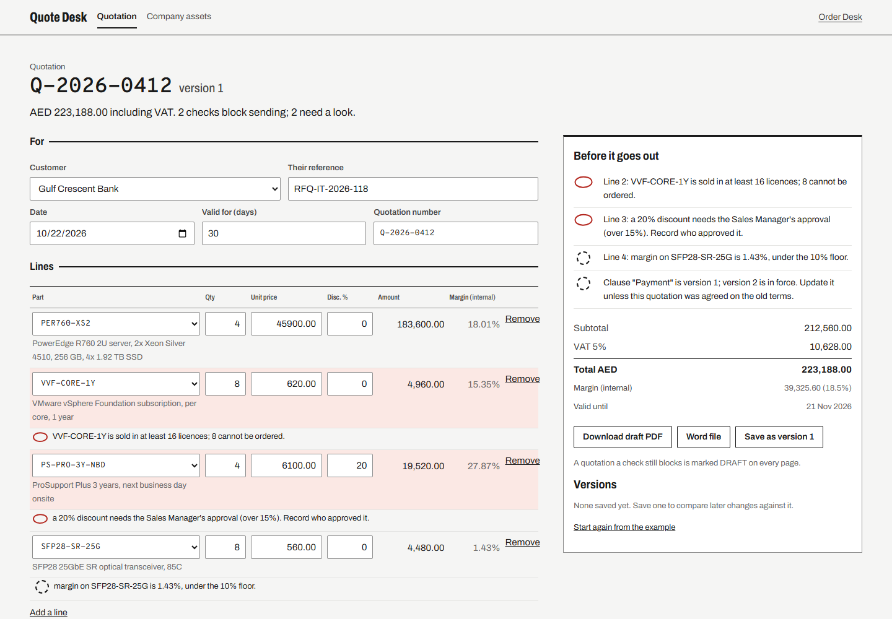
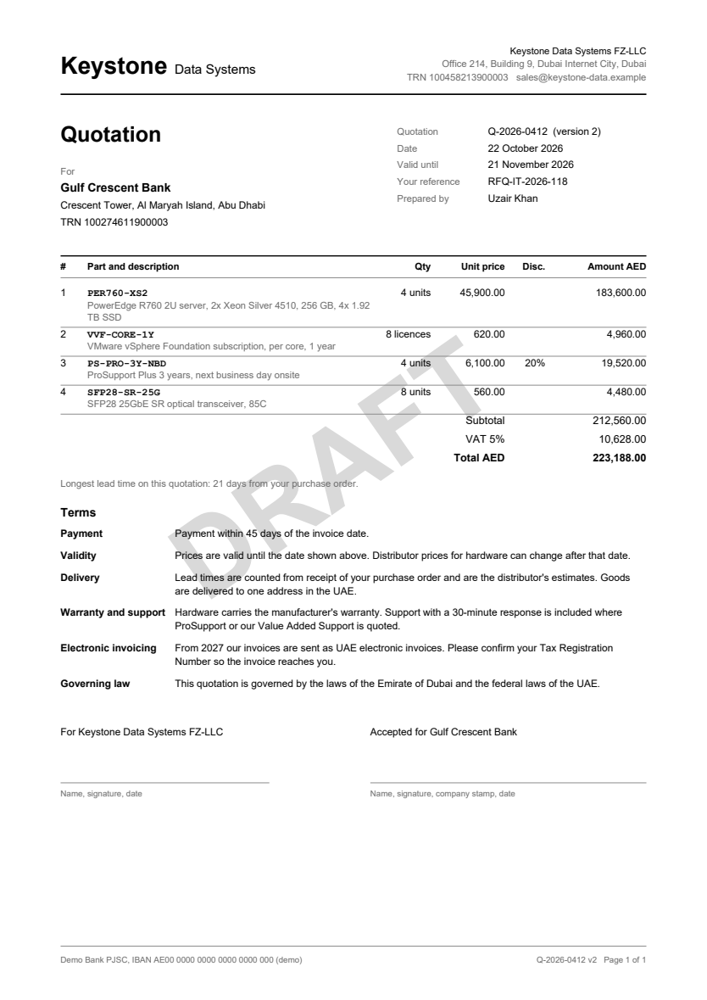

# Quote Desk

Quotations checked before they go out, and written from one approved template as a PDF or a Word file. The
company's pieces (letterhead details, clauses and their versions, the commercial policy) live in one place, so
every document is built from the same, current parts.

**Live:** https://quote-desk-ae.vercel.app (made-up company, products and prices)



## What it does

- **Builds a quotation** from the catalogue: customer, lines with quantity, price and discount, validity, terms.
  Amount, VAT and the internal margin update as you type.
- **Checks it before it goes out**, each finding one sentence, and says whether it blocks sending:
  - quoted below our cost (blocks), margin under the 10% floor (warning)
  - a discount over 15% without a recorded approver (blocks)
  - a quantity under the pack size or minimum, such as VMware licences per 16 cores (blocks)
  - validity already past (blocks), a customer with no TRN on file (warning: the tax invoice and, from 2027, the
    electronic invoice need it)
  - a clause in an old version, or the payment or validity clause left out (warning)
- **Writes the document** from one template, in Python: a PDF with the letterhead, lines, totals, terms and
  signature blocks, page numbers on every page, and **DRAFT across every page while commercial checks block
  sending**; and the same content as a Word file for procurement teams that mark quotations up. Text the PDF
  fonts cannot draw is flagged during checks and refused by the PDF download; Word keeps it.
- **Keeps versions**: save version 1, change the draft, and see in words what changed ("PER760-XS2: unit price
  45,900.00 to 44,900.00."). History stays with the quotation when its number changes, and saving continues
  beyond version 99. Quotation numbers use the API's whitespace normalization for storage and conflicts.
- **Company assets** page: the brand rule, the letterhead details, every clause with its version history (in force,
  retired, from and to), and the policy the checks enforce.



## How it is built

- **API** ([`app.py`](app.py), [`backend/`](backend)): Flask. [`quote.py`](backend/quote.py) validates the input
  with pydantic, computes every figure in `Decimal` rounded half-up to the fils, and runs the checks;
  [`render_pdf.py`](backend/render_pdf.py) draws the PDF with reportlab (drawn twice so "Page n of N" is right);
  [`render_docx.py`](backend/render_docx.py) writes the Word file with python-docx. Stateless: the reference data
  ships with the app.
- **Web** ([`web/`](web)): React, Vite, TypeScript. Drafts and versions stay in the browser.
- **Data** ([`data/`](data)): products, customers and the company are the same synthetic ones as
  [Order Desk](https://github.com/f20230125-sudo/order-desk) ([`tools/export_data.py`](tools/export_data.py)); costs,
  minimum quantities and lead times are made up but typical in shape. Clauses and policy are in
  [`data/assets.json`](data/assets.json).

## Run it

```bash
python -m venv .venv && .venv/Scripts/pip install -r requirements-dev.txt     # Python 3.14
.venv/Scripts/python -m flask --app app run -p 5201
npm --prefix web ci && npm --prefix web run dev                                # http://127.0.0.1:5200
```

Tests: `pytest` (90: figures, every check, document validation, PDF metadata wrapping, glyph checks, download
headers, versions beyond 99, the PDF text and page numbering, the Word file, the API and the setup command),
`npm --prefix web test` (17: version comparison, number normalization, quotation identity, saved history and API
payloads), `npm --prefix web run e2e`
(18 in a real browser: editing, downloads, versions, renaming, tab conflicts, storage failures and stale checks, with axe
accessibility checks in light and dark). The browser tests use Flask and Vite running locally as above.

## Limits

- One currency (AED) and one VAT rate (5%).
- No logins or approval workflow: the approver is a name typed on the quotation.
- Drafts and versions live in one browser, not in a database.
- PDF uses built-in fonts. Arabic and other text those fonts cannot draw produce field-specific blocking
  findings during checks and a 400 response for PDF downloads. The Word file preserves the text; no fonts or
  Arabic shaping support are bundled.
- Synthetic company, products and prices.

Built by Uzair Khan.
